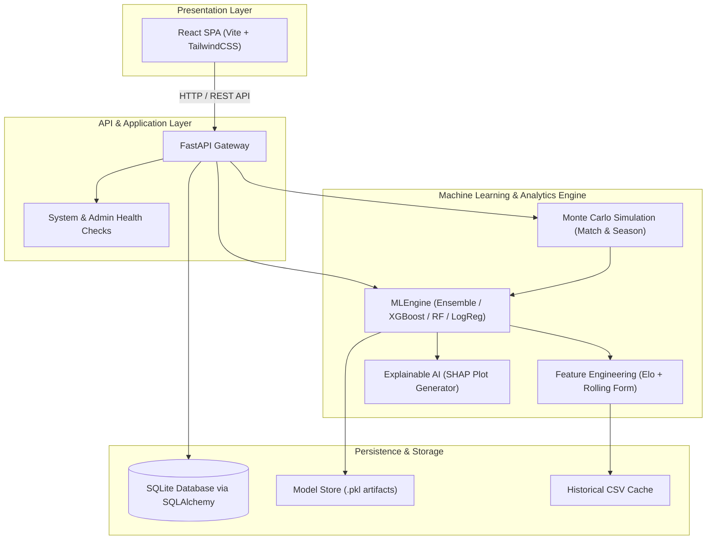

# ⚽ EPL Match Predictor Platform

[](https://fastapi.tiangolo.com)
[](https://react.dev)
[](https://vitejs.dev)
[](https://tailwindcss.com)
[](https://www.docker.com)
[](https://opensource.org/licenses/MIT)

A lightweight, production-ready full-stack machine learning platform engineered to predict English Premier League (EPL) football match outcomes with explainable AI (XAI) and Monte Carlo season simulation.

---

## 🏗️ Architecture Overview

The platform uses a modular architecture connecting a responsive React SPA frontend to an asynchronous FastAPI backend and an MLOps pipeline.



---

## ✨ Key Features

- **Instant Match Predictions:** No login required. Anyone can instantly select EPL clubs and compute match outcome probabilities.
- **Multi-Model Support:** Choose between **RandomForest**, **XGBoost**, **Logistic Regression**, or an **Ensemble Average** of all three.
- **Dynamic Feature Engineering:** Computes dynamic Elo ratings and rolling team form (points per game, goals scored, goals conceded) from multi-season match histories.
- **Explainable AI (XAI):** Integrated **SHAP** (SHapley Additive exPlanations) generates visual bar charts showing the exact feature contributions for each prediction.
- **Monte Carlo Simulations:**
  - `/simulate-match`: Simulates probabilistic match outcomes across 100 iterations.
  - `/simulate-season`: Simulates remaining league fixtures across customizable rounds (up to 500) to project final standings.
- **Open Admin Tools:** Direct access to model retraining and health check endpoints for maintenance and demonstrations.
- **Automated MLOps Retraining:** Scheduled GitHub Actions workflow retrains the model on fresh league data and commits updated model artifacts.
- **Direct GitHub Pages Deployment:** Built and deployed automatically from the `main` branch via GitHub Actions.
- **Extensible Agent Skills:** Includes 45 modular agent skills under `.agents/skills/` (featuring [DietrichGebert/ponytail](https://github.com/DietrichGebert/ponytail) and [mattpocock/skills](https://github.com/mattpocock/skills)).

---

## 🚀 Quickstart with Docker Compose

### Prerequisites
- [Docker](https://docs.docker.com/get-docker/) & Docker Compose
- [Git](https://git-scm.com/)

### 1. Clone the Repository
```bash
git clone https://github.com/anwrG-p/EPL-Predictor.git
cd EPL-Predictor
```

### 2. Configure Environment
Copy the example environment file:
```bash
cp .env.example .env
```

### 3. Launch Services
```bash
docker-compose up --build -d
```
The services will be available at:
- **Frontend Web UI:** [http://localhost:3000](http://localhost:3000)
- **Backend API:** [http://localhost:8000](http://localhost:8000)
- **Interactive API Docs (Swagger):** [http://localhost:8000/docs](http://localhost:8000/docs)

### 4. Train Initial Model
Run the setup command inside the backend container:

```bash
docker-compose exec backend python scripts/train_manual.py
```

---

## 🌐 API Reference

| Method | Endpoint | Description |
| :--- | :--- | :--- |
| `GET` | `/health` | Service health check |
| `GET` | `/admin/health` | Admin Panel health monitor |
| `POST` | `/predict` | Generate match outcome probabilities & SHAP explanation URL |
| `POST` | `/simulate-match` | Run Monte Carlo match simulation (100 rounds) |
| `GET` | `/simulate-season` | Run Monte Carlo season simulation (query param: `rounds`) |
| `POST` | `/admin/retrain` | Trigger model retraining pipeline |
| `GET` | `/admin/stats` | View total prediction count |

### Prediction Request Example

**POST** `/predict`

```json
{
  "home_team": "Manchester City",
  "away_team": "Arsenal"
}
```

**Response:**
```json
{
  "probs": {
    "Home": 0.52,
    "Draw": 0.26,
    "Away": 0.22
  },
  "shap_url": "/admin/shap/man_city_vs_arsenal.png",
  "features": {
    "Elo_Home": 1940.2,
    "Elo_Away": 1895.8,
    "Home_Form_Pts": 2.4,
    "Away_Form_Pts": 2.0,
    "Home_Form_GF": 2.2,
    "Away_Form_GF": 1.8,
    "Home_Form_GA": 0.8,
    "Away_Form_GA": 1.0
  }
}
```

---

## ⚙️ Configuration (`.env`)

| Variable | Default | Description |
| :--- | :--- | :--- |
| `DATABASE_URL` | `sqlite:///./data/backend.db` | SQLAlchemy database connection URI |
| `MODEL_TYPE` | `ensemble` | Selected model: `rf`, `xgb`, `logreg`, or `ensemble` |
| `OPTUNA_STUDY_NAME` | `epl_optimization` | Optuna hyperparameter study identifier |

---

## 🧪 Local Development & Testing

### Backend Unit Tests
```bash
pytest backend/tests
```

### Frontend Build
```bash
cd frontend
npm install
npm run build
```

---

## 🤖 Agent Skills Installed

This repository is equipped with agent skills managed via [skills-lock.json](skills-lock.json):
- **Ponytail Suite:** `ponytail`, `ponytail-audit`, `ponytail-debt`, `ponytail-gain`, `ponytail-help`, `ponytail-review`.
- **Engineering & Architecture:** `code-review`, `codebase-design`, `diagnosing-bugs`, `domain-modeling`, `tdd`, `to-spec`, `to-tickets`, `wayfinder`.
- **Productivity & Review:** `ask-matt`, `grill-me`, `grill-with-docs`, `handoff`, `writing-for-agents`.

---

## 📄 License

This project is licensed under the [MIT License](LICENSE).
